<!-- ╔════════════════════════════════════════════════════════════════╗ -->
<!-- ║   BLOOM STUDIO • Chinmayi Magdum • Secure AI Systems            ║ -->
<!-- ║   Replace: YOUR_USERNAME • YOUR-LINKEDIN • YOUR-PORTFOLIO-LINK  ║ -->
<!-- ╚════════════════════════════════════════════════════════════════╝ -->

<div align="center">


<br/>

<a href="https://git.io/typing-svg">
  
</a>

<br/>

<a href="https://YOUR-PORTFOLIO-LINK">
  
</a>
&nbsp;
<a href="https://linkedin.com/in/YOUR-LINKEDIN">
  
</a>
&nbsp;
<a href="mailto:chinmayimagdum@gmail.com">
  
</a>
&nbsp;
<a href="https://github.com/YOUR_USERNAME">
  
</a>

<br/><br/>


&nbsp;

&nbsp;

&nbsp;

&nbsp;

&nbsp;


</div>

<br/>
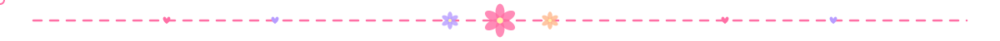

<!-- ═══════════════ ABOUT ═══════════════ -->
<div align="center">

<a href="https://git.io/typing-svg">
  
</a>

<br/><br/>


<br/><br/>

> *AI/ML engineering student with a strong interest in cybersecurity and secure systems.*
> *I build projects where AI meets security: RAG defense, safe database access, and encryption.*

</div>

<br/>


<!-- ═══════════════ PROJECTS ═══════════════ -->
<div align="center">

<a href="https://git.io/typing-svg">
  
</a>

<br/><br/>

<table border="0" cellspacing="0" cellpadding="8">
<tr>
<td><a href="https://github.com/YOUR_USERNAME/VectorShield"></a></td>
<td><a href="https://github.com/YOUR_USERNAME/QueryPilot-MCP"></a></td>
</tr>
<tr>
<td><a href="https://github.com/YOUR_USERNAME/HOMOMORPHIC-VOTING-REPO"></a></td>
<td><a href="https://github.com/YOUR_USERNAME/PADDY-LEAF-REPO"></a></td>
</tr>
</table>

<sub>VectorShield live demo: add the demo link here → <a href="https://YOUR-VECTORSHIELD-DEMO">Demo</a></sub>

</div>

<br/>


<!-- ═══════════════ ARCHITECTURE ═══════════════ -->
<div align="center">

<a href="https://git.io/typing-svg">
  
</a>

</div>

**VectorShield: RAG defense pipeline**

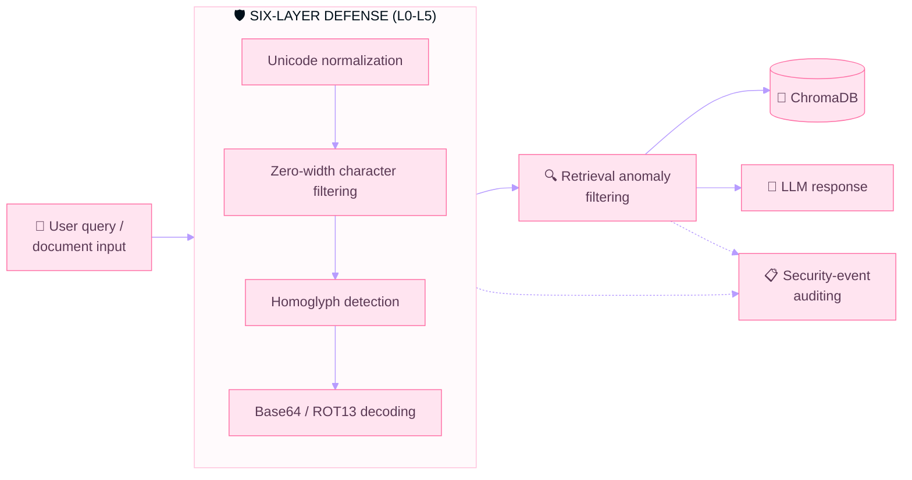

**QueryPilot MCP: safe database access**

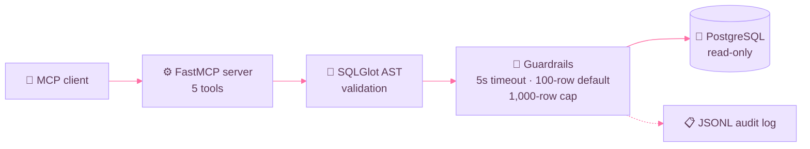

<br/>


<!-- ═══════════════ SKILLS ═══════════════ -->
<div align="center">

<a href="https://git.io/typing-svg">
  
</a>

<br/><br/>


<br/><br/>


</div>

<br/>


<!-- ═══════════════ ACHIEVEMENTS ═══════════════ -->
<div align="center">

<a href="https://git.io/typing-svg">
  
</a>

<br/><br/>


</div>

<br/>


<!-- ═══════════════ GITHUB STATS ═══════════════ -->
<div align="center">

<a href="https://git.io/typing-svg">
  
</a>

<br/><br/>


&nbsp;


<br/><br/>


<br/><br/>


<br/><br/>

<!-- Snake needs .github/workflows/snake.yml. Run it once from the Actions tab. -->
<picture>
  <source media="(prefers-color-scheme: dark)" srcset="https://raw.githubusercontent.com/YOUR_USERNAME/YOUR_USERNAME/output/snake-dark.svg" />
  
</picture>

</div>

<br/>


<!-- ═══════════════ CURRENT FOCUS ═══════════════ -->
<div align="center">

<a href="https://git.io/typing-svg">
  
</a>

</div>

```
╭───────────────────────────────────────────────────────────────╮
│ ✿ 01  AI Security                                  ACTIVE     │
│       Prompt injection · RAG poisoning · Defense pipelines    │
├───────────────────────────────────────────────────────────────┤
│ ✿ 02  Secure Systems                               ACTIVE     │
│       Cryptography · Secure DB access · Audit logging         │
├───────────────────────────────────────────────────────────────┤
│ ✿ 03  RAG & LLM Applications                       ACTIVE     │
│       Embeddings · Vector search · ChromaDB · Qdrant          │
├───────────────────────────────────────────────────────────────┤
│ ✿ 04  Model Context Protocol                       BUILDING   │
│       FastMCP servers · Tool design · Safe query execution    │
├───────────────────────────────────────────────────────────────┤
│ ✿ 05  Full-Stack Web                               LEARNING   │
│       React · TypeScript · FastAPI · Docker deployment        │
╰───────────────────────────────────────────────────────────────╯
```

<br/>


<!-- ═══════════════ LEARNING PATH ═══════════════ -->
<div align="center">

<a href="https://git.io/typing-svg">
  
</a>

</div>

```mermaid
%%{init: {'theme':'base', 'themeVariables': { 'primaryColor': '#ffe4f0', 'primaryTextColor': '#5b3a55', 'primaryBorderColor': '#b79cff', 'lineColor': '#ff6fa5'}}}%%
flowchart LR
    A["🌱 Python &<br/>SQL"] --> B["🌷 Cryptography &<br/>Network Security"]
    B --> C["🌸 ML & Deep<br/>Learning"]
    C --> D["🌼 LLMs & RAG"]
    D --> E["🍀 Prompt Injection<br/>Security"]
    E --> F["🌺 MCP Servers"]
    F --> G["💐 Docker &<br/>Deployment"]
    style A fill:#e0faf2,stroke:#8be9c8,stroke-width:2px
    style B fill:#ffe4f0,stroke:#ff6fa5,stroke-width:2px
    style C fill:#ede4ff,stroke:#b79cff,stroke-width:2px
    style D fill:#fff0e6,stroke:#ffb88c,stroke-width:2px
    style E fill:#e0faf2,stroke:#8be9c8,stroke-width:2px
    style F fill:#ffe4f0,stroke:#ff6fa5,stroke-width:2px
    style G fill:#ede4ff,stroke:#b79cff,stroke-width:2px
```

<br/>


<!-- ═══════════════ OPEN TO ═══════════════ -->
<div align="center">

<a href="https://git.io/typing-svg">
  
</a>

<br/><br/>


</div>

<br/>


<!-- ═══════════════ CONNECT ═══════════════ -->
<div align="center">

<a href="https://git.io/typing-svg">
  
</a>

<br/><br/>

> *Building secure AI systems, safe data access layers, or RAG defense tooling?*
> ***Let's build something lovely and hard to break.***

<br/>

<a href="mailto:chinmayimagdum@gmail.com"></a>
&nbsp;
<a href="https://linkedin.com/in/YOUR-LINKEDIN"></a>
&nbsp;
<a href="https://YOUR-PORTFOLIO-LINK"></a>

<br/><br/>

<a href="https://git.io/typing-svg">
  
</a>

<br/><br/>


</div>
